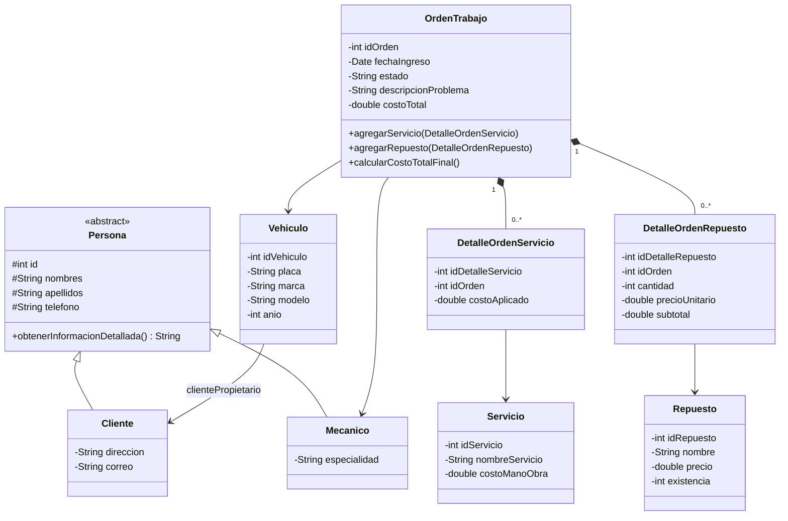
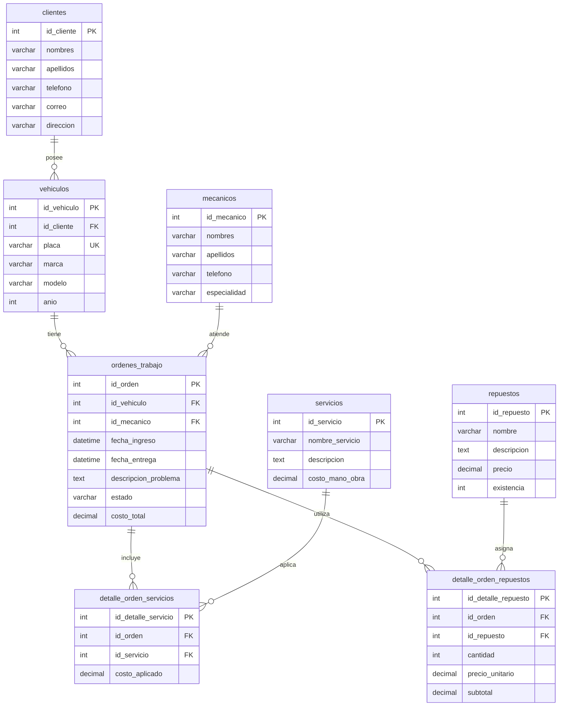
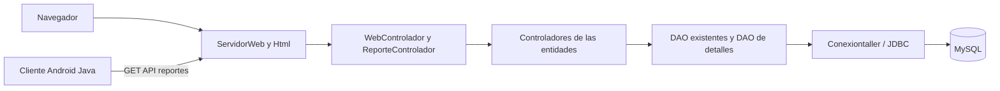

# Diagramas del proyecto

## Clases del modelo

Los campos privados, getters/setters y validaciones conservan el encapsulamiento. Cliente y Mecanico implementan polimórficamente obtenerInformacionDetallada y se usan en los comprobantes. Las colecciones de detalles participan en las órdenes y reportes. Los montos conservan double para compatibilidad con la implementación recibida y se normalizan a centavos; MySQL almacena DECIMAL(10,2).

## Entidad-relación

## Capas y flujo

TransaccionOrden bloquea la orden al cambiar sus detalles y bloquea/actualiza existencias mediante SQL dentro de la misma conexión. La operación confirma detalle, stock y total juntos o revierte todo. Los datos de prueba del SQL usan exclusivamente las ocho entidades ya existentes.
